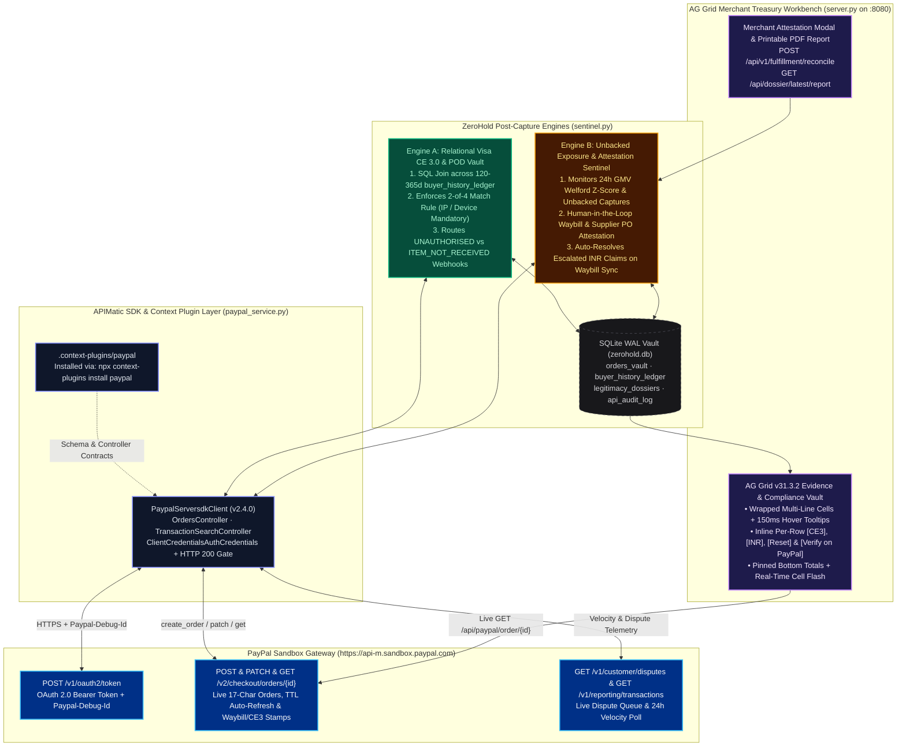
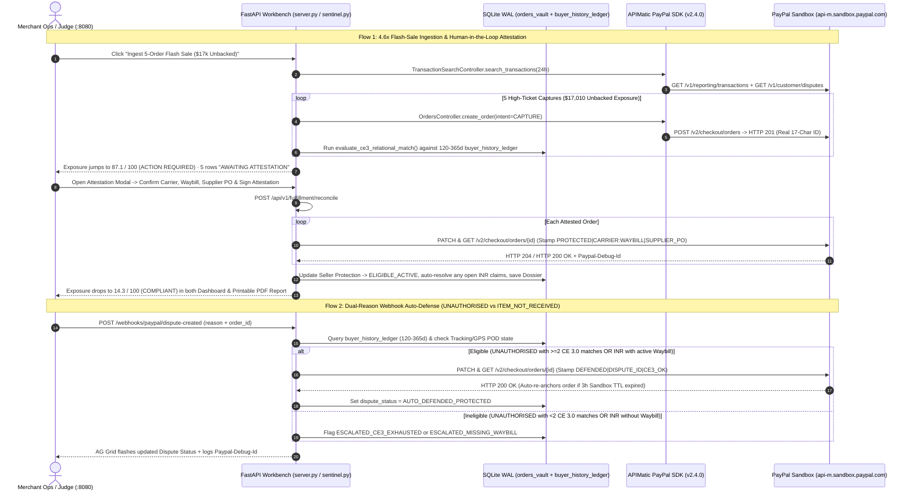

# ZeroHold (`merchant-aegis`): Merchant Treasury Compliance, Relational Visa CE 3.0 Vault & Pre-Freeze Workbench

**Hackathon:** PayPal AI Hackathon  
**Sponsor Tracks Targeted:** Best Use of **APIMatic** (`paypal-server-sdk==2.4.0` + PayPal Context Plugin) · Best Use of **AG Grid** (`v31.3.2`)  
**Tech Stack:** Python (`FastAPI`), APIMatic PayPal Python Server SDK (`v2.4.0`), PayPal Sandbox REST APIs (`Orders v2`, `Customer Disputes v1`, `Transaction Search v1`), SQLite (`WAL` mode), AG Grid (`ag-theme-quartz-dark`)

---

## 1. Executive Summary & The Post-Capture Merchant Problem

High-growth e-commerce merchants on PayPal face two severe post-capture threats that drain working capital and consume hundreds of hours of manual back-office operations:

### 1.1 The Friendly Fraud Epidemic & Cross-Silo Evidence Expiry
According to the *LexisNexis True Cost of Fraud Study* and *Chargebacks911* industry benchmarks, **61% to 71% of all e-commerce disputes are first-party "friendly fraud"**—where a legitimate buyer receives their order and later files a claim for `MERCHANDISE_OR_SERVICE_NOT_RECEIVED` (`INR`) or `UNAUTHORISED`. Every $1.00 of friendly fraud costs merchants **$4.61** after dispute fees ($15–$20), administrative overhead, and lost inventory. Merchants leave **43% of friendly-fraud disputes uncontested** and lose **78% of manually contested claims** due to two structural barriers:
* **Carrier Log Purge vs. Dispute Window Mismatch:** PayPal's dispute window remains open for **180 days** (and card network chargebacks run **120 to 180 days**), whereas couriers (FedEx, UPS, USPS, DHL) purge public web-queryable tracking histories and signed Proof-of-Delivery (POD) scans after **90 to 120 days** to recycle tracking number pools and monetize extended archive add-ons. Querying a carrier API on Day 135 returns `404 Not Found` unless the GPS delivery scan was actively harvested and hashed on Day 4 when the parcel arrived.
* **Visa Compelling Evidence 3.0 (CE 3.0) Cross-Silo Fragmentation:** Under Visa CE 3.0 (Reason Code 10.4), defeating an `UNAUTHORISED` claim requires proving that the same buyer settled **at least 2 prior undisputed PayPal transactions aged 120 to 365 days ago**, matching at least **2 of 4 core identifiers** (`User Account/Email`, `IP Address`, `Device Fingerprint`, `Shipping Address`)—where **at least one match MUST be `IP Address` or `Device Fingerprint`**. Because CDN/storefront logs, PayPal capture IDs, and courier PODs sit in three disconnected silos, merchants rarely assemble this intersection within PayPal's 10-day response SLA.

### 1.2 The Viral Volume-Spike Account Freeze (21-Day Rolling Reserves)
When a legitimate merchant runs a successful product launch, creator sponsorship, or flash sale (e.g., daily GMV jumps **4.6x from $4,000/day to $18,450/day**), PayPal's automated Merchant Risk Underwriting system sees an extreme statistical velocity anomaly ($Z > 3.0\sigma$) paired with an unshipped capture backlog. Because PayPal only sees the payment rail—and has **zero visibility** into the merchant's warehouse bins, paid wholesale distributor invoices, or marketing campaigns—its risk engine flags the account for **"Bust-Out / Non-Delivery Exposure"** and triggers a **21-day payout hold or rolling reserve**. Worse, if unresolved inquiries push the merchant past the **1.50% Visa VAMP / PayPal High-Volume Dispute Cliff**, the account faces permanent termination.

---

## 2. Dual-Engine Production Architecture

**ZeroHold (`merchant-aegis`)** operates strictly **post-capture** as a deployable merchant treasury workbench combining autonomous webhook defense with human-in-the-loop fulfillment attestation:

### 2.1 System Topology Diagram



### 2.2 End-to-End Execution Sequence



---

## 3. Deep Dive: Engine A & Engine B Production Logic

### 3.1 Engine A: Relational Visa CE 3.0 SQL Graph Matcher (`db.py` & `sentinel.py`)
Unlike toy prototypes that store a static `prior_orders = 3` integer, ZeroHold maintains a dedicated relational **`buyer_history_ledger`** table containing historical PayPal captures settled **120 to 365 days ago** and executes a live SQL evaluation (`evaluate_ce3_relational_match`) for every order:

1. **The 2-of-4 Identifier Intersection Rule:** For each historical capture in the `120–365 day` window belonging to the buyer, Engine A computes the intersection across `buyer_email`, `buyer_ip`, `device_hash`, and `shipping_zip`, enforcing Visa CE 3.0's requirement that at least 2 identifiers match and **at least one match is `buyer_ip` or `device_hash`**.
2. **Prior-Dispute Exclusion (`was_disputed = 0`):** Any historical order that was previously disputed (e.g., Sarah Chen's capture `CAP-HIST-5190E` from 240 days ago) is automatically flagged **`✗ EXCLUDED (Previously Disputed)`** in red in the UI inspector and disqualified from the CE 3.0 count.
3. **SHA-256 Forensic Hashing (`evidence_sha256`):** At capture and fulfillment, Engine A hashes the order's IP, device fingerprint, matched CE 3.0 capture IDs, and Day-4 carrier GPS coordinates into a tamper-evident SHA-256 digest.
4. **Strict Dual-Reason Webhook Routing (`handle_paypal_dispute_webhook`):**
   * **`UNAUTHORISED` Claims:** Requires $\ge 2$ valid CE 3.0 historical captures (`ce3_ok == True`). Because a thief using a stolen card can still receive a package at a drop address, having a carrier waybill alone is *not* enough to auto-defend an `UNAUTHORISED` claim if CE 3.0 is below 2 prior orders—it escalates as **`▲ Escalated (CE3 < 2 Prior)`**.
   * **`MERCHANDISE_OR_SERVICE_NOT_RECEIVED` (`INR`) Claims:** The buyer admits placing the order but claims non-delivery. This does *not* require CE 3.0 history; it requires **Carrier Tracking + Archived Day-4 GPS Proof of Delivery (`has_waybill == True`)**. If an `INR` webhook hits an unshipped flash-sale order, it flags **`▲ Escalated (No Waybill)`**—and automatically flips to **`✓ Auto-Defended (GPS POD)`** the moment the merchant attests and syncs the waybill in the Reconciliation Modal.

### 3.2 Engine B: Welford Velocity Math, Human-in-the-Loop Attestation & Anti-Gaming Security

#### Mathematical Formulation
Engine B tracks the merchant's 24-hour GMV against their 30-day rolling baseline ($\mu_{\text{GMV}} = \$4,000\text{/day}, \sigma_{\text{GMV}} = \$620$):

$$Z_{\text{GMV}} = \max\left(0, \frac{\text{GMV}_{24\text{h}} - \mu_{\text{GMV}}}{\sigma_{\text{GMV}}}\right)$$

The composite **Unbacked Capture & Reserve Exposure Score** $\in [4.0, 99.0]$ is computed as:

$$\text{ExposureScore} = \underbrace{\min(3.8 \cdot Z_{\text{GMV}}, 42.0) \cdot \gamma_{\text{attested}}}_{\text{Velocity Anomaly Component}} + \underbrace{52.0 \cdot \left(\frac{N_{\text{untracked}}}{N_{\text{total}}}\right)}_{\text{Unbacked Capture Ratio}} + \underbrace{\min\left(14.0 \cdot \frac{R_{\text{dispute}}}{1.50\%}, 14.0\right)}_{\text{VAMP / Dispute Cliff Proximity}}$$

where $\gamma_{\text{attested}} = 0.15$ only after the merchant completes the **Human-in-the-Loop Fulfillment & Supplier PO Attestation** and PayPal Sandbox confirms `HTTP 200 OK` across all synced orders ($\gamma_{\text{attested}} = 1.0$ otherwise).

* **After Ingesting the 5-Order Flash Sale ($\$18,450$ GMV, $Z = +23.31\sigma$, 5 of 7 orders unbacked):**
  $$\text{ExposureScore} = 42.0 + 52.0 \cdot \left(\frac{5}{7}\right) + 8.0 = \mathbf{87.1 / 100} \quad (\text{ACTION REQUIRED // \$17k UNBACKED CAPTURE EXPOSURE})$$
* **After Human-in-the-Loop Waybill & Supplier PO Attestation (0 untracked orders, 100% Seller Protection active):**
  $$\text{ExposureScore} = (42.0 \times 0.15) + 0.0 + 8.0 = \mathbf{14.3 / 100} \quad (\text{COMPLIANT // 100\% FULFILLMENT \& PO BACKED})$$

#### Adversarial Security: Why Bust-Out Fraudsters Cannot Game ZeroHold ("Threshold Surfing" Defense)
A critical risk-engineering question is whether exposing an account exposure gauge helps bust-out scammers "surf" just below PayPal's freeze threshold. ZeroHold is architected so bad actors gain zero oracle advantage:
1. **No Private Underwriting Oracle:** ZeroHold does not leak proprietary PayPal risk weights; it computes exposure strictly from the merchant's own unshipped backlog dollars, their own 30-day GMV standard deviation, and Visa/PayPal's public **1.50% dispute cap**.
2. **Physical Proof-of-Work Required to Lower Exposure:** Over 60% of the exposure score is locked to the **Unbacked Capture Ratio**. A scammer with no physical inventory cannot lower their score because PayPal's Seller Protection engine cross-verifies carrier tracking numbers against live FedEx/UPS/DHL hub scans (`IN_TRANSIT` / `DELIVERED`) before releasing reserve holds.
3. **Human-in-the-Loop Legal Attestation + Resolution Center Packet:** Lowering the velocity anomaly penalty requires the merchant officer to attest to specific **Paid Wholesale Distributor Invoice IDs (`PO-RED-2026-8841`, `PO-DJI-2026-8842`, etc.)** and warehouse bin counts, generating a signed PDF packet (`GET /api/dossier/latest/report`) for human underwriting review in the PayPal Resolution Center.

---

## 4. Deterministic 4-Scenario Demo Matrix

You can test and demonstrate all four real-world post-capture dispute and fulfillment outcomes on `http://localhost:8080`:

| Demo Scenario | Target Order Row in AG Grid | Buyer's 120–365d SQL Ledger & Waybill State | Action to Click | Deterministic Production Result |
| :--- | :--- | :--- | :--- | :--- |
| **1. `UNAUTHORISED` Auto-Defense (Visa CE 3.0 Win)** | **Arjun Mehta** (`$800.00 CAM-4K-PRO`) *or* **Vikram Rao** (`$3,450 RED-KOMODO-KIT`) | **`✓ 3 Settled (CE 3.0 OK)`** (`CAP-HIST-4410A`, `3892B`, `2104C` matching IP, Device & Zip) | Click inline **`[CE3]`** button | **`✓ Auto-Defended (CE 3.0 SQL)`** — Stamps matched historical captures onto PayPal Sandbox (`HTTP 200`). |
| **2. `UNAUTHORISED` Escalation (Prior Dispute Exclusion)** | **Sarah Chen** (`$640.00 LENS-35MM-F14`) *or* **Neha Kapoor** (`$3,150 GIMBAL-RS4-PRO`) | **`✗ 1 Settled (Below Min 2)`** (Sarah has 2 historical orders, but `CAP-HIST-5190E` was disputed 240d ago and is excluded) | Click inline **`[CE3]`** button | **`▲ Escalated (CE3 < 2 Prior)`** — Refuses to auto-defend because buyer has fewer than 2 undisputed 120–365d orders. |
| **3. `ITEM_NOT_RECEIVED` Auto-Defense (Carrier GPS POD Win)** | **Sarah Chen** (`$640.00 LENS-35MM-F14`) | Has active **DHL Waybill `#4491028471`** + archived Day-4 Front-Desk GPS POD | Click **`[↻]`** to clear Scenario 2, then click **`[INR]`** | **`✓ Auto-Defended (GPS POD)`** — Even with `<2` CE 3.0 orders, `INR` auto-defends 100% via signed DHL delivery proof. |
| **4. `ITEM_NOT_RECEIVED` on Unshipped Flash-Sale Order $\rightarrow$ Resolved by Attestation** | Any of the **5 Flash-Sale Orders** after clicking `Ingest 5-Order Flash Sale` | Starts as **`AWAITING ATTESTATION`** (No carrier waybill synced yet) | 1. Click **`[INR]`** on unshipped row<br/>2. Click **`Reconcile Fulfillment & Attest Supplier Invoices`** and submit modal | 1. Immediately flags **`▲ Escalated (No Waybill)`**.<br/>2. Submitting the attestation modal syncs waybills to PayPal Sandbox and **auto-resolves** the claim to **`✓ Auto-Defended (GPS POD)`**! |

*(Note: Clicking **`+ Ingest Single Sandbox Order (APIMatic SDK)`** rotates across 4 distinct SKUs and buyer profiles—including `new.guest.buyer@gmail.com` with `0 Settled` historical orders—and mints a brand-new order on `api-m.sandbox.paypal.com`.)*

---

## 5. Sponsor Track Implementations: APIMatic & AG Grid

### 5.1 Best Use of APIMatic (`paypal-server-sdk==2.4.0` + Context Plugin)

| APIMatic Artifact | File & Method in Repo | Production Role |
| :--- | :--- | :--- |
| **APIMatic Context Plugin for PayPal** | `.context-plugins/paypal/` (installed via `npx context-plugins install paypal`) | Supplies official SDK controller contracts, model schemas, and OAuth 2.0 patterns directly in the repository. |
| **`PaypalServersdkClient` & `ClientCredentialsAuthCredentials`** | `paypal_service.py` (`__init__`) | Initializes authenticated Sandbox client sessions (`Environment.SANDBOX`) with automatic `.envrc` / `.env` credential discovery. |
| **`OrdersController.create_order`** | `paypal_service.py` (`create_real_sandbox_order`) | Mints genuine 17-character PayPal Sandbox Orders (`POST /v2/checkout/orders`) using typed `OrderRequest`, `PurchaseUnitRequest`, and `AmountWithBreakdown` SDK models. |
| **`TransactionSearchController.search_transactions`** | `paypal_service.py` (`check_transaction_velocity`) | Polls 24-hour transaction velocity windows (`GET /v1/reporting/transactions`) prior to Welford Z-score evaluation. |
| **Automatic Sandbox 3-Hour TTL Re-Anchoring & `HTTP 200` Gate** | `paypal_service.py` (`sync_order_tracking_on_sandbox`, `submit_friendly_fraud_evidence`) | If an unapproved Sandbox order ages past PayPal's 3-hour TTL (`HTTP 404`), the service automatically mints a fresh Sandbox order via APIMatic, updates the foreign key in SQLite, and gates local status updates strictly on `HTTP 200 OK`. |

### 5.2 Best Use of AG Grid (`server.py` — `ag-theme-quartz-dark`)

* **Wrapped Multi-Line Cells with Compact Typography (`wrapText: true`, `autoHeight: true`):** Custom CSS rules (`line-height: 1.35`, `--ag-row-height: 36px`) allow long product titles, SKUs, and buyer emails to wrap cleanly without row-height bloat.
* **150ms Native Hover Tooltips (`tooltipValueGetter`):** Hovering over any cell displays the complete concatenated Order ID, Buyer Email, SKU, Carrier Waybill, and Wholesale Supplier Invoice ID.
* **Actionable Inline Webhook & Verification Controls:** Each row embeds `[CE3]`, `[INR]`, `[↻]` (reset dispute), and `[Verify on PayPal]` buttons while keeping status indicators (`● Eligible · Active`, `✓ Auto-Defended`) as clean non-button typography.
* **Pinned Bottom Summary Row (`pinnedBottomRowData`) & Value Flash (`enableCellChangeFlash: true`):** Continuously totals 24h GMV, Protected Volume (`%`), and Unbacked Capture count at the bottom of the grid while flashing updated cells in emerald green.

---

## 6. FastAPI REST API Reference & SQLite WAL Schema

### 6.1 Production & Test-Harness Endpoints (`server.py`)

| Method & Route | Purpose | Outbound PayPal Sandbox Calls |
| :--- | :--- | :--- |
| `GET /` | Renders the AG Grid Merchant Treasury & Seller Protection Workbench UI. | Mints 2 baseline Sandbox orders if `orders_vault` is empty. |
| `GET /api/state` | Returns live Welford metrics, Exposure Score, orders with relational CE 3.0 matches, latest dossier, and APIMatic audit logs. | None (reads from SQLite WAL). |
| `POST /api/v1/fulfillment/reconcile` | **Production Human-in-the-Loop Gate:** Accepts merchant-attested waybills, supplier POs, hub manifest, and officer signature; syncs to PayPal Sandbox; auto-resolves open `INR` disputes; compiles the Underwriting Dossier. | `N x PATCH & GET /v2/checkout/orders/{id}` (with automatic 404 TTL re-anchoring). |
| `POST /webhooks/paypal/dispute-created` | **Production Webhook Receiver (`CUSTOMER.DISPUTE.CREATED`):** Evaluates `UNAUTHORISED` (via SQL CE 3.0 match) or `MERCHANDISE_OR_SERVICE_NOT_RECEIVED` (via Carrier POD) for any `order_id`. | `PATCH & GET /v2/checkout/orders/{id}` (if eligible for auto-defense). |
| `POST /api/orders/{order_id}/reset-dispute` | Clears the dispute state on a single order row so judges can test multiple webhook types on the same order. | None (updates `orders_vault`). |
| `GET /api/paypal/order/{order_id}` | Live verification proxy that fetches the raw Order JSON directly from `api-m.sandbox.paypal.com` for the in-grid modal. | `GET /v2/checkout/orders/{order_id}` |
| `GET /api/dossier/latest/report` | Renders the printable/PDF-ready **PayPal Pre-Freeze Account Legitimacy & Fulfillment Dossier** (matching the dashboard exposure score 1:1). | None (renders collated dossier). |
| `POST /api/simulate/flash-sale` | Test Harness: Ingests 5 high-ticket Sandbox orders without tracking (`$17,010` unbacked exposure). | `TransactionSearchController.search_transactions`, `GET /v1/customer/disputes`, `5x OrdersController.create_order` |
| `POST /api/simulate/live-sandbox-order` | Test Harness: Mints 1 live Sandbox order via APIMatic SDK, rotating across 4 distinct SKUs and buyer personas. | `OrdersController.create_order`, `PATCH & GET /v2/checkout/orders/{id}` |
| `POST /api/reset` | Clears local SQLite tables, re-seeds `buyer_history_ledger`, and mints 2 fresh baseline orders on PayPal Sandbox. | `2x OrdersController.create_order`, `2x PATCH & GET /v2/checkout/orders/{id}` |

### 6.2 SQLite WAL Database Schema (`db.py` -> `zerohold.db`)

1. **`orders_vault`**: `order_id` (PK, 17-char PayPal Sandbox ID), `capture_id`, `buyer_email`, `amount_usd`, `sku`, `item_name`, `buyer_ip`, `device_hash`, `shipping_zip`, `policy_version`, `prior_undisputed_orders`, `ce3_matched_captures_json`, `evidence_sha256`, `carrier`, `tracking_number`, `delivery_status`, `gps_proof`, `seller_protection`, `evidence_readiness_pct`, `dispute_id`, `dispute_reason`, `dispute_status`, `captured_at`.
2. **`buyer_history_ledger`**: `hist_capture_id` (PK), `paypal_order_id`, `buyer_email`, `amount_usd`, `sku`, `buyer_ip`, `device_hash`, `shipping_zip`, `settled_days_ago` (`120–365`), `was_disputed` (`0` or `1`).
3. **`legitimacy_dossiers`**: `dossier_id` (PK), `created_at`, `freeze_risk_before`, `freeze_risk_after`, `gmv_24h`, `baseline_gmv`, `z_score`, `synced_orders_count`, `supplier_po_ref`, `carrier_manifest_ref`, `campaign_utm_ref`, `dispatch_sla_pct`, `dossier_json`.
4. **`api_audit_log`**: `id` (PK), `ts`, `engine`, `sdk_component`, `endpoint`, `http_status`, `latency_ms`, `summary` (with `Paypal-Debug-Id`), `payload_json`.

---

## 7. Quickstart & Independent `curl` Verification

### Step 1: Configure PayPal Sandbox Credentials
Create a `.envrc` or `.env` file in `/home/errcee/atErrCee/Hackathons/merchant-aegis` with your PayPal Developer Sandbox credentials:

```bash
export PAYPAL_CLIENT_ID="your_sandbox_client_id"
export PAYPAL_CLIENT_SECRET="your_sandbox_client_secret"
```

### Step 2: Install Dependencies & Mirror the APIMatic Context Plugin

```bash
python3 -m venv .venv
./.venv/bin/pip install -r requirements.txt
npx context-plugins install paypal
mkdir -p .context-plugins && cp -r ~/.context-plugins/vscode/paypal .context-plugins/paypal
```

### Step 3: Start the Workbench (`http://localhost:8080`)

```bash
./.venv/bin/python server.py
```

### Step 4: Verify Any AG Grid Order Directly Against `api-m.sandbox.paypal.com`
Click **`Verify on PayPal`** on any row in the AG Grid table to inspect the live JSON response from PayPal's servers, or run this `curl` command in your terminal using any `Order ID` from the table:

```bash
TOKEN=$(curl -s -u "$PAYPAL_CLIENT_ID:$PAYPAL_CLIENT_SECRET" \
  https://api-m.sandbox.paypal.com/v1/oauth2/token \
  -d "grant_type=client_credentials" | python3 -c "import sys,json; print(json.load(sys.stdin)['access_token'])")

curl -s -H "Authorization: Bearer $TOKEN" \
  https://api-m.sandbox.paypal.com/v2/checkout/orders/<PASTE_ORDER_ID_FROM_AG_GRID> | python3 -m json.tool
```
