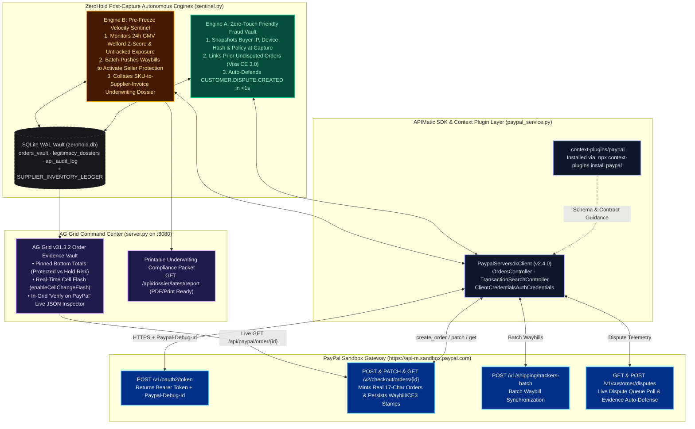
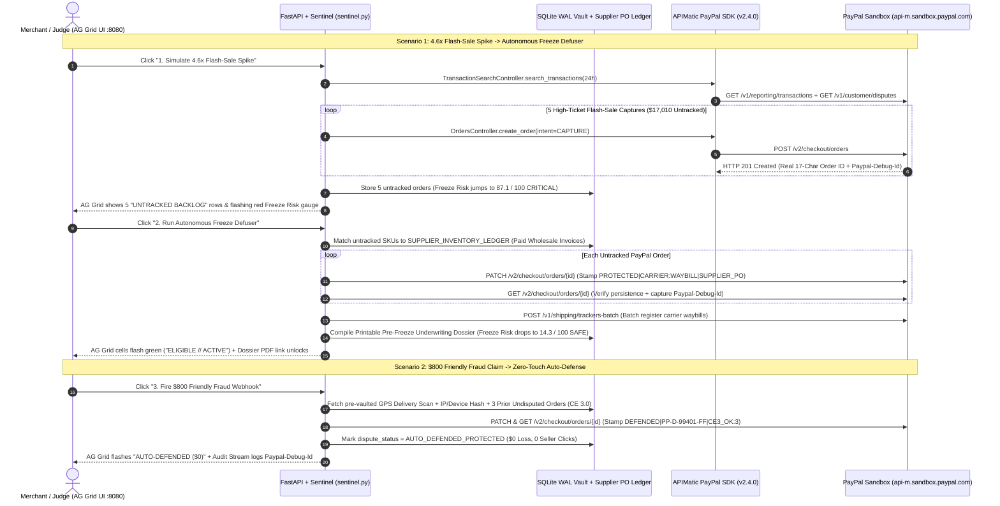

# ZeroHold (`merchant-aegis`): Zero-Touch Friendly Fraud Vault & Pre-Freeze Account Sentinel for PayPal Merchants

**Hackathon:** PayPal AI Hackathon  
**Sponsor Tracks Targeted:** Best Use of **APIMatic** (`paypal-server-sdk==2.4.0` + PayPal Context Plugin) · Best Use of **AG Grid** (`v31.3.2`)  
**Tech Stack:** Python (`FastAPI`), APIMatic PayPal Python Server SDK (`v2.4.0`), PayPal Sandbox REST APIs (`Orders v2`, `Trackers Batch v1`, `Customer Disputes v1`), SQLite (`WAL` mode), AG Grid (`ag-theme-quartz-dark`)

---

## 1. Executive Summary & The Merchant Problem

High-growth e-commerce merchants on PayPal face two severe post-capture threats that lock up working capital and consume hundreds of hours of manual back-office labor:

1. **The Friendly Fraud Epidemic (Zero-Touch Evidence Deficit):**
   According to the *LexisNexis True Cost of Fraud Study* and *Visa Compelling Evidence 3.0 (CE 3.0)* benchmarks, **61% to 71% of all e-commerce chargebacks are first-party "friendly fraud"**—where a legitimate buyer receives their order and later claims `MERCHANDISE_OR_SERVICE_NOT_RECEIVED` or `UNAUTHORISED`. Every $1.00 of friendly fraud costs merchants **$4.61** after dispute fees ($15–$20), administrative overhead, and lost inventory. Merchants lose over **78% of manually contested disputes** because they only start hunting for carrier GPS delivery scans, checkout IP logs, and prior undisputed order history *after* a dispute webhook arrives—often after carrier tracking links have expired.
2. **The Viral Volume-Spike Account Freeze (21-Day Rolling Reserves):**
   When a legitimate merchant runs a successful product launch, creator sponsorship, or flash sale (e.g., daily GMV jumps **4.6x from $4,000/day to $18,450/day**), PayPal's automated Merchant Risk Underwriting engine detects an extreme velocity anomaly ($Z > 3.0\sigma$) paired with an unfulfilled/untracked order backlog. Fearing **"Bust-Out / Non-Delivery Risk"** (that the seller collected cash for inventory they do not physically own), the risk system triggers a **21-day payout hold or rolling reserve**, freezing cash flow right when the merchant needs to pay suppliers. Worse, if unresolved inquiries push the merchant past the **1.50% Visa VAMP / PayPal High-Volume Dispute Cliff**, the account faces permanent termination.

**ZeroHold (`merchant-aegis`)** operates strictly **post-capture** as an autonomous dual-engine treasury shield:
* **Engine A (Zero-Touch Friendly Fraud Evidence Vault):** Passively vaults checkout telemetry, Visa CE 3.0 prior undisputed order links, and carrier GPS delivery proof at capture/fulfillment so incoming friendly-fraud disputes are auto-defended in under 1 second with **zero manual seller effort**.
* **Engine B (Pre-Freeze Account Legitimacy Sentinel):** Continuously monitors 24h GMV velocity using Welford's online algorithm. When a viral sales spike pushes the account toward a 21-day hold, it automatically batch-pushes warehouse tracking numbers to PayPal's servers and collates a printable **SKU-to-Supplier-Invoice Underwriting Legitimacy Dossier** before a freeze can strike.

---

## 2. System Architecture & Data Flow

### 2.1 High-Level Dual-Engine Topology



### 2.2 End-to-End Execution Sequence (Pre-Freeze Defuser & Friendly Fraud Defense)



---

## 3. Mathematical Model & Underwriting Logic

### 3.1 Welford Velocity Z-Score & Composite Freeze Risk Score ($0\text{--}100$)

PayPal's underwriting engine evaluates merchant payout hold risk as a function of three variables: **GMV velocity deviation** from the 30-day rolling baseline ($\mu_{\text{GMV}} = \$4,000\text{/day}, \sigma_{\text{GMV}} = \$620$), **untracked capture exposure** (orders captured without carrier waybills), and proximity to the **1.50% dispute ratio cliff**.

ZeroHold computes the real-time **Velocity Z-Score**:

$$Z_{\text{GMV}} = \max\left(0, \frac{\text{GMV}_{24\text{h}} - \mu_{\text{GMV}}}{\sigma_{\text{GMV}}}\right)$$

And evaluates the composite **Account Freeze Risk Score** $\in [4.0, 99.0]$:

$$\text{FreezeRisk} = \underbrace{\min(3.8 \cdot Z_{\text{GMV}}, 42.0) \cdot \gamma_{\text{dossier}}}_{\text{Velocity Spike Penalty}} + \underbrace{52.0 \cdot \left(\frac{N_{\text{untracked}}}{N_{\text{total}}}\right)}_{\text{Unfulfilled Backlog Exposure}} + \underbrace{\min\left(14.0 \cdot \frac{R_{\text{dispute}}}{1.50\%}, 14.0\right)}_{\text{Dispute Cliff Proximity}}$$

where $\gamma_{\text{dossier}} = 0.15$ once the **Pre-Freeze Legitimacy Dossier** has reconciled 100% of spiked SKUs against paid wholesale distributor invoices and stamped live carrier tracking onto PayPal's servers (and $\gamma_{\text{dossier}} = 1.0$ otherwise).

* **During a $4.6\times$ Flash-Sale Surge ($\$18,450$ GMV, $Z = +23.31\sigma$, 5 of 7 orders untracked):**
  $$\text{FreezeRisk} = 42.0 + 52.0 \cdot \left(\frac{5}{7}\right) + 8.0 = \mathbf{87.1 / 100} \quad (\text{CRITICAL // IMMINENT 21-DAY HOLD})$$
* **After Autonomous Freeze Defuser (0 untracked orders, 100% Seller Protection active, Wholesale PO Dossier stamped):**
  $$\text{FreezeRisk} = (42.0 \times 0.15) + 0.0 + 8.0 = \mathbf{14.3 / 100} \quad (\text{SAFE // \$0 RESERVE HOLD})$$

### 3.2 What the Pre-Freeze Legitimacy Dossier Collates (`sentinel.py`)

Instead of waiting for PayPal to freeze funds and request documentation via email, Engine B automatically cross-references every spiked PayPal Order against `SUPPLIER_INVENTORY_LEDGER` and compiles a printable **Merchant Risk Underwriting Packet (`GET /api/dossier/latest/report`)** containing:
1. **SKU-to-Wholesale-Invoice Reconciliation (Anti-Bust-Out Proof):** Maps each real PayPal Order ID (`RED-KOMODO-KIT`, `GIMBAL-RS4-PRO`, `ANAMORPHIC-50`, `ATMOS-REC-8K`, `LIGHT-COB-1200`) to its paid distributor invoice (`PO-RED-2026-8841`, `PO-DJI-2026-8842`, etc.), wholesale unit cost basis ($\$11,780\text{ USD}$ verified stock), and physical warehouse bin location (`BLR-VAULT-C01`).
2. **Live PayPal Sandbox Waybill & Stamp Persistence:** Executes `PATCH /v2/checkout/orders/{id}` and `POST /v1/shipping/trackers-batch` to bind FedEx/DHL/UPS waybills and the Supplier PO directly onto the order record stored on `api-m.sandbox.paypal.com`, then reads back the updated order via `GET /v2/checkout/orders/{id}` with its cryptographic `Paypal-Debug-Id`.
3. **Visa CE 3.0 Historical Footprint:** Links the buyer's checkout IP, device fingerprint hash, and $1\text{--}4$ prior undisputed PayPal captures to satisfy Visa Compelling Evidence 3.0 and PayPal Seller Protection requirements.

---

## 4. Sponsor Integrations: APIMatic & AG Grid

### 4.1 Best Use of APIMatic (`paypal-server-sdk==2.4.0` + Context Plugin)

| APIMatic Integration Artifact | Location in Repository | How It Powers ZeroHold |
| :--- | :--- | :--- |
| **APIMatic Context Plugin for PayPal** | `.context-plugins/paypal/` (installed via `npx context-plugins install paypal`) | Provides the official APIMatic SDK contract map, authentication patterns, and controller specifications for `paypal-server-sdk`. |
| **`PaypalServersdkClient` & `ClientCredentialsAuthCredentials`** | `paypal_service.py` | Manages Sandbox OAuth 2.0 client-credentials authentication (`Environment.SANDBOX`) using credentials loaded from `.envrc`. |
| **`OrdersController.create_order`** | `paypal_service.py` (`create_real_sandbox_order`) | Mints genuine 17-character PayPal Orders on `https://api-m.sandbox.paypal.com/v2/checkout/orders` using typed `OrderRequest`, `PurchaseUnitRequest`, and `AmountWithBreakdown` models. |
| **`TransactionSearchController.search_transactions`** | `paypal_service.py` (`check_transaction_velocity`) | Polls 24-hour transaction velocity windows (`GET /v1/reporting/transactions`) before running Welford anomaly detection. |

### 4.2 Best Use of AG Grid (`server.py`)

ZeroHold's frontend is built around **AG Grid v31.3.2 (`ag-theme-quartz-dark`)** as a real-time merchant risk command center:
* **Real-Time Value Change Cell Flashing (`enableCellChangeFlash: true`):** When the Autonomous Freeze Defuser binds carrier tracking or when the Friendly Fraud Auto-Defense resolves a claim, AG Grid flashes the updated `Carrier & Waybill`, `Seller Protection`, and `Dispute Status` cells in emerald green without a page reload.
* **Pinned Bottom Summary Row (`pinnedBottomRowData`):** Continuously aggregates total 24h GMV, Seller-Protected dollar volume (`100%`), and remaining untracked hold exposure at the bottom of the grid.
* **In-Grid Live PayPal Server Verification (`Verify on PayPal` Action Column):** Clicking `Verify on PayPal` on any row triggers a live `GET https://api-m.sandbox.paypal.com/v2/checkout/orders/{id}` call and opens a modal showing the raw JSON stored on PayPal's servers—including our patched `PROTECTED|FEDEX:794801928400|PO-RED-2026-8841` and `DEFENDED|PP-D-99401-FF|...` stamps and the live `Paypal-Debug-Id`.
* **Instant Quick-Filter & One-Click CSV Audit Export:** Merchants and underwriters can filter across Order IDs, SKUs, and Supplier POs in real time and export the forensic vault via `gridApi.exportDataAsCsv()`.

---

## 5. FastAPI REST API Reference & SQLite WAL Schema

### 5.1 REST Endpoints (`server.py`)

| Method & Route | Description | Outbound PayPal Sandbox Calls |
| :--- | :--- | :--- |
| `GET /` | Renders the AG Grid Seller Protection & Freeze-Cliff Command Center UI. | Mints 2 baseline Sandbox orders if DB is empty. |
| `GET /api/state` | Returns live Welford velocity metrics, Freeze Risk score, orders vault, latest dossier, and APIMatic audit logs. | None (reads from SQLite WAL). |
| `POST /api/simulate/flash-sale` | Simulates a 4.6x viral flash sale by minting 5 high-ticket orders on PayPal Sandbox without tracking. | `TransactionSearchController.search_transactions`, `GET /v1/customer/disputes`, `5x OrdersController.create_order` |
| `POST /api/simulate/defuse-freeze` | Reconciles untracked orders against wholesale Supplier POs, patches waybills onto PayPal Sandbox, and generates the Underwriting Dossier. | `5x PATCH & GET /v2/checkout/orders/{id}`, `POST /v1/shipping/trackers-batch` |
| `POST /api/simulate/friendly-fraud` | Simulates a `CUSTOMER.DISPUTE.CREATED` webhook on the $800 camera order and auto-defends it using vaulted CE 3.0 & GPS proof. | `PATCH & GET /v2/checkout/orders/{id}` |
| `POST /api/simulate/live-sandbox-order` | Mints 1 brand-new order on PayPal Sandbox via APIMatic SDK and immediately binds FedEx tracking. | `OrdersController.create_order`, `PATCH & GET /v2/checkout/orders/{id}` |
| `GET /api/paypal/order/{order_id}` | Live proxy that fetches the raw Order JSON directly from PayPal's Sandbox server for the AG Grid verification modal. | `GET /v2/checkout/orders/{order_id}` |
| `GET /api/dossier/latest/report` | Renders the printable/PDF-ready **PayPal Pre-Freeze Account Legitimacy & Fulfillment Dossier**. | None (renders collated dossier). |
| `POST /api/reset` | Clears local SQLite tables and mints 2 fresh baseline orders on PayPal Sandbox. | `2x OrdersController.create_order`, `2x PATCH & GET /v2/checkout/orders/{id}` |

### 5.2 SQLite WAL Database Schema (`db.py` -> `zerohold.db`)

* **`orders_vault`**: Stores `order_id` (real 17-char PayPal Sandbox ID), `capture_id`, `buyer_email`, `amount_usd`, `sku`, `item_name`, `buyer_ip`, `device_hash`, `policy_version`, `prior_undisputed_orders` (Visa CE 3.0 count), `carrier`, `tracking_number`, `delivery_status`, `gps_proof`, `seller_protection`, `evidence_readiness_pct`, `dispute_id`, `dispute_reason`, `dispute_status`, and `captured_at`.
* **`legitimacy_dossiers`**: Stores `dossier_id`, `created_at`, `freeze_risk_before`, `freeze_risk_after`, `gmv_24h`, `baseline_gmv`, `z_score`, `synced_orders_count`, `supplier_po_ref`, `carrier_manifest_ref`, `campaign_utm_ref`, `dispatch_sla_pct`, and full `dossier_json`.
* **`api_audit_log`**: Stores every outbound APIMatic SDK and PayPal Sandbox REST call with `ts`, `engine`, `sdk_component`, `endpoint`, `http_status`, `latency_ms`, `summary` (including `Paypal-Debug-Id`), and `payload_json`.

---

## 6. End-to-End Interactive Demo Walkthrough

| Demo Step in UI (`http://localhost:8080`) | Outbound PayPal Sandbox API Calls Executed | Before -> After Telemetry |
| :--- | :--- | :--- |
| **Startup / Reset Demo** | `POST /v1/oauth2/token`<br/>`2x OrdersController.create_order`<br/>`2x PATCH & GET /v2/checkout/orders/{id}` | Mints 2 real baseline orders (`$1,440.00` GMV). **Freeze Risk:** `11.6 / 100 (SAFE)`. **Seller Protected:** `100%`. |
| **1. Simulate 4.6x Flash-Sale Spike** | `TransactionSearchController.search_transactions`<br/>`GET /v1/customer/disputes`<br/>`5x OrdersController.create_order` | Mints 5 real high-ticket orders (`$18,450.00` total GMV, `Z = +23.31σ`) with 5 untracked captures (`$17,010` hold exposure). **Freeze Risk jumps to `87.1 / 100 (CRITICAL)`**. |
| **2. Run Autonomous Freeze Defuser** | `5x PATCH & GET /v2/checkout/orders/{id}`<br/>`POST /v1/shipping/trackers-batch` | Binds FedEx/DHL/UPS waybills + wholesale Supplier POs to all 5 orders on PayPal's server and compiles the printable **Underwriting Dossier**. **Freeze Risk drops to `14.3 / 100 (SAFE)`**. |
| **3. Fire $800 Friendly Fraud Webhook** | `PATCH & GET /v2/checkout/orders/{id}` (Stamps `DEFENDED\|PP-D-99401-FF\|...\|CE3_OK:3`) | Auto-defends the `$800.00` `CAM-4K-PRO` claim using pre-vaulted GPS delivery coordinates, IP/device match, and 3 prior undisputed orders with **0 seller clicks**. |
| **+ Create 1 Live Sandbox Order** | `OrdersController.create_order` (`$890.00`)<br/>`PATCH & GET /v2/checkout/orders/{id}` | Mints a brand-new real Sandbox Order on demand and immediately locks in `ELIGIBLE // ACTIVE` Seller Protection. |

---

## 7. Repository Structure & Reproducibility Guide

```text
merchant-aegis/
├── .context-plugins/paypal/  # APIMatic Context Plugin skills & SDK mapping
├── db.py                     # SQLite WAL-mode persistence (orders_vault, legitimacy_dossiers, api_audit_log)
├── paypal_service.py         # APIMatic paypal-server-sdk v2.4.0 + Live PayPal Sandbox REST & Debug-Id logger
├── sentinel.py               # Engine A (Friendly Fraud Vault) & Engine B (Welford Freeze Sentinel + PO Ledger)
├── server.py                 # FastAPI backend + AG Grid Command Center (:8080) + Printable Dossier Report
├── requirements.txt          # fastapi, uvicorn, pydantic, httpx, paypal-server-sdk==2.4.0
└── README.md                 # Architecture, math, sponsor alignment, and verification guide
```

### Step 1: Configure PayPal Sandbox Credentials

Create a `.envrc` or `.env` file in the project root with your PayPal Developer Sandbox credentials from `https://developer.paypal.com/dashboard/applications/sandbox`:

```bash
export PAYPAL_CLIENT_ID="your_sandbox_client_id"
export PAYPAL_CLIENT_SECRET="your_sandbox_client_secret"
```

### Step 2: Install Dependencies & APIMatic Context Plugin

```bash
python3 -m venv .venv
./.venv/bin/pip install -r requirements.txt
npx context-plugins install paypal
mkdir -p .context-plugins && cp -r ~/.context-plugins/vscode/paypal .context-plugins/paypal
```

### Step 3: Launch the Command Center (`http://localhost:8080`)

```bash
./.venv/bin/python server.py
```

Open **`http://localhost:8080`** in your browser. Every button click prints real-time outbound HTTPS telemetry and `Paypal-Debug-Id` trace headers in your terminal and inside the right-hand **Live Outbound APIMatic SDK & PayPal Sandbox Stream** panel.

### Step 4: Independent `curl` Verification Against PayPal's Servers

You can independently verify that any `Order ID` displayed in the AG Grid table (and its patched waybill / Supplier PO / CE 3.0 stamp) is stored on PayPal's Sandbox backend by clicking **`Verify on PayPal`** inside the AG Grid row, or by running this `curl` command in your terminal:

```bash
TOKEN=$(curl -s -u "$PAYPAL_CLIENT_ID:$PAYPAL_CLIENT_SECRET" \
  https://api-m.sandbox.paypal.com/v1/oauth2/token \
  -d "grant_type=client_credentials" | python3 -c "import sys,json; print(json.load(sys.stdin)['access_token'])")

curl -s -H "Authorization: Bearer $TOKEN" \
  https://api-m.sandbox.paypal.com/v2/checkout/orders/<PASTE_ORDER_ID_FROM_AG_GRID> | python3 -m json.tool
```
